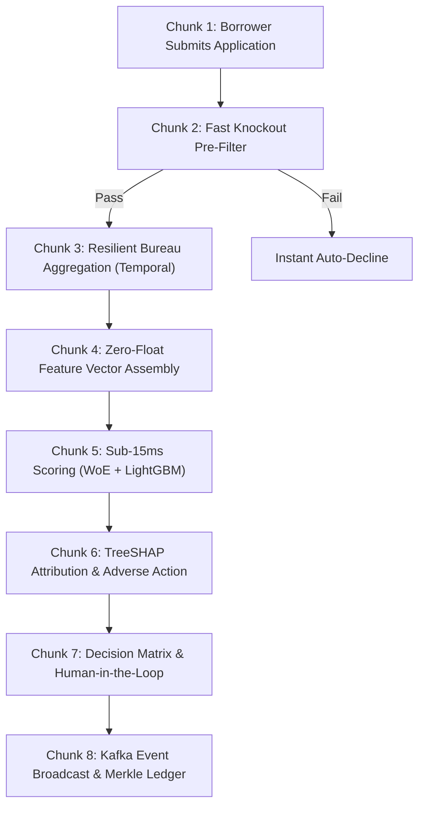

# 03 — Step-by-Step Execution Flow in Chunks

This document walks through the complete end-to-end loan application lifecycle in **8 bite-sized, sequential chunks**.

To make the flow concrete, we follow **Alex Chen**, a freelance software designer applying for a **$10,000 personal loan** at 11:42 PM on a Saturday.



---

### 🔹 Chunk 1: The Borrower Submits (Frontend & Ingestion)

1. **The Form**: Alex opens the Next.js UI (`/apply`), enters his details (gross monthly income: $\$5,000$, requested loan: $\$10,000$ for home office upgrades), and checks the FCRA consent box.
2. **The Idempotency Key**: Alex’s browser generates a time-ordered UUIDv7 token (`idemp-01918a2b-4c5d...`) and attaches it to the HTTP header.
3. **The Dragonfly Check**: The Go API Gateway receives `POST /api/v1/applications`. Before touching PostgreSQL, Go queries **DragonflyDB**:
   ```
   SETNX idempotency:idemp-01918a2b-4c5d... EX 86400
   ```
4. **Why this matters**: If Alex experiences lag on his mobile connection and taps "Submit" four times, Dragonfly intercepts the subsequent requests in **$< 1\text{ms}$** and returns `409 Conflict`, preventing duplicate loans from being originated.

---

### 🔹 Chunk 2: The Fast Knockout Gate (Instant Pre-Filter)

Before making costly third-party API calls, the Go Core service evaluates deterministic hard policy rules in microsecond memory:
- Is Alex at least 18 years old? $\rightarrow$ **Yes (32)**.
- Any active or recent bankruptcy in the trailing 36 months? $\rightarrow$ **No**.
- Is Alex on an OFAC or international sanctions watchlist? $\rightarrow$ **No**.
- Does stated Debt-to-Income ($DTI$) exceed $60\%$? $\rightarrow$ **No ($28\%$)**.

**Outcome**: Knockout passed. Go creates an initial record in PostgreSQL (`status: 'SUBMITTED', version: 1`) and dispatches the execution to Temporal.

---

### 🔹 Chunk 3: Resilient Bureau Aggregation (Temporal Saga)

Go launches a Temporal workflow: `UnderwritingWorkflow(app_id)`:
1. **Activity `FetchBureauData`**: Temporal initiates an API call to an external credit bureau (simulated Experian / TransUnion mock).
2. **The Resiliency Test (Timeout Handling)**:
   - Suppose Experian’s servers experience a network hiccup and return an `HTTP 504 Gateway Timeout`.
   - *In legacy systems*: The application crashes, the database is left in a dirty state, and Alex sees an error screen.
   - *In CrediVect*: **Temporal catches the timeout automatically**. It activates its exponential retry policy (waits 1s, retries; waits 2s, retries). On the second attempt, Experian returns Alex’s credit file cleanly. Alex experiences zero errors.
3. **Persistence**: The bureau tradelines, revolving balances, and inquiry counts are persisted into PostgreSQL with both **Valid Time** (when the credit event occurred) and **Transaction Time** (when CrediVect ingested it).

---

### 🔹 Chunk 4: Zero-Float Feature Vector Assembly

Go aggregates the application data with the bureau report to compute the standardized numerical Feature Vector:
- **Debt-to-Income ($DTI$)**: $\frac{\$1,700 \text{ total monthly debt}}{\$5,000 \text{ income}} = 34.00\% \rightarrow \mathbf{3,400\text{ bps}}$
- **Revolving Credit Utilization**: $\frac{\$4,250 \text{ balance}}{\$10,000 \text{ total limit}} = 42.50\% \rightarrow \mathbf{4,250\text{ bps}}$
- **Delinquencies in 24 Months**: $\mathbf{1}$ (a single 30-day late payment 18 months ago).
- **Hard Inquiries in 6 Months**: $\mathbf{2}$.

**Financial Invariant**: Notice that there are **zero floating-point numbers**. Every value is represented as integer cents or basis points to eliminate IEEE-754 rounding errors.

---

### 🔹 Chunk 5: The Quantitative Scoring Brain (Python gRPC)

Temporal transmits this feature vector over localhost **gRPC** to the **Python Scoring Microservice** (`services/scoring`):
1. **Model A (Monotonic WoE Scorecard)**:
   - Evaluates statistical bins (Weight of Evidence) to calculate baseline credit points $\rightarrow$ **Score: 674** (Near-Prime).
2. **Model B (LightGBM Gradient Boosted Trees)**:
   - Evaluates complex non-linear feature interactions with monotonic constraints.
   - Calibrates raw tree log-odds via Platt Scaling to true empirical probability:
     $$\mathbf{PD = 0.0465} \quad (4.65\% \text{ probability of default over 12 months})$$
3. **Execution Latency**: The dual calculation finishes in **$< 10\text{ms}$**.

---

### 🔹 Chunk 6: TreeSHAP Attribution & Adverse Action

Within the same sub-15ms gRPC execution, Python executes **TreeSHAP**:
1. **Local Mathematical Attribution**:
   - Calculates the exact points added or subtracted by each feature:
     - *Positive factors*: Reliable income history, low inquiry count ($+32\text{ points}$).
     - *Negative factors*: High revolving credit utilization ($-28\text{ points}$), past 30-day delinquency ($-15\text{ points}$).
2. **FCRA Compliance**: If the application requires adverse action, the top negative factors are mapped to official reason codes:
   - `AA01`: Proportion of balances to credit limits is too high.
   - `AA02`: Delinquency reported on accounts.
3. Python returns `{ score: 674, pd: 0.0465, tier: "NEAR_PRIME", reasons: [...] }` back to Go.

---

### 🔹 Chunk 7: Decision Matrix & Human-in-the-Loop Fork

Temporal evaluates the risk tier:
- **Path 1 (Score $\ge 720$ — Super-Prime/Prime)**: Automated instant approval! Limit: $\$10,000$, APR: $9.5\%$.
- **Path 2 (Score $< 600$ — High Risk)**: Automated instant decline with top 4 Adverse Action codes.
- **Path 3 (Score $660\text{--}719$ — Near-Prime "Gray Zone")** $\leftarrow$ **Alex is here (674)**:
  1. The workflow transitions Alex’s status to `IN_REVIEW`.
  2. **The Durable Sleep**: Temporal registers a **72-hour timer**. The workflow pauses execution, burning zero CPU threads or server resources.
  3. **Underwriter Action**: On Sunday morning, a credit risk officer logs into the Underwriter Dashboard (`/dashboard`), inspects Alex’s interactive **SHAP waterfall chart**, sees his healthy freelance income trajectory, and decides to approve him with an adjusted limit: **$\$7,500$ at $11.8\%$ APR**.
  4. **The Temporal Signal**: The underwriter clicks "Approve". The UI executes `POST /api/v1/applications/{id}/review`, transmitting a `ReviewerDecisionSignal` into the sleeping Temporal workflow, **instantly resuming execution**.

---

### 🔹 Chunk 8: Kafka Event Broadcast & Merkle Hash Ledger

With the decision finalized:
1. **Kafka Event Broadcast**: Temporal publishes events to **Apache Kafka**:
   - `credit.application.scored` $\rightarrow$ Consumed by the telemetry worker to track live **Population Stability Index (PSI)** for model drift.
   - `underwriting.decision.approved` $\rightarrow$ Consumed by the Core Banking / Loan Management System (LMS) to provision Alex’s loan account.
2. **Tamper-Evident Merkle Ledger**:
   - A final snapshot is written to the append-only `AUDIT_LEDGER` table in PostgreSQL:
     $$\text{entry\_hash} = \text{SHA-256}(\text{previous\_entry\_hash} + \text{payload\_hash} + \text{timestamp})$$
   - **Audit Guarantee**: Any rogue database administrator attempting to alter historical underwriting decisions breaks the cryptographic hash chain, providing non-repudiable proof of compliance during federal audits.
